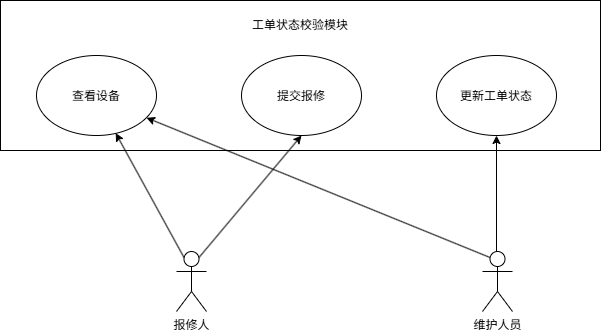

## 角色说明
- 报修人：查看设备信息，提交报修工单
- 维护人员：查看设备信息，更新工单状态

## 用例详情
### UC01 查看设备
参与者：报修人、维护人员
前置条件：无
后置条件：返回对应设备信息；设备不存在给出提示
主流程：参与者输入设备编号，系统查询并展示设备信息
异常流程：输入设备编号不存在，系统给出提示

### UC02 提交报修工单
参与者：报修人
前置条件：无
后置条件：工单创建，状态为 PENDING
主流程：报修人选择清单内设备，填写非空故障描述，系统生成工单，状态置 PENDING
异常流程：故障描述为空或者输入信息不全，不创建工单

### UC03 更新工单状态
参与者：维护人员
前置条件：工单已经存在
后置条件：合法则更新工单状态；非法流转拒绝变更
主流程：维护人员发起工单状态变更；系统校验状态流转规则，校验通过更新状态
异常流程：状态流转不符合业务规则，拒绝状态变更

## 图的自查
- [x] 两个参与者
- [x] 三个主要用例
- [x] 系统边界清楚
- [x] 参与者与用例连接正确
- [x] 源文件与导出图内容一致
